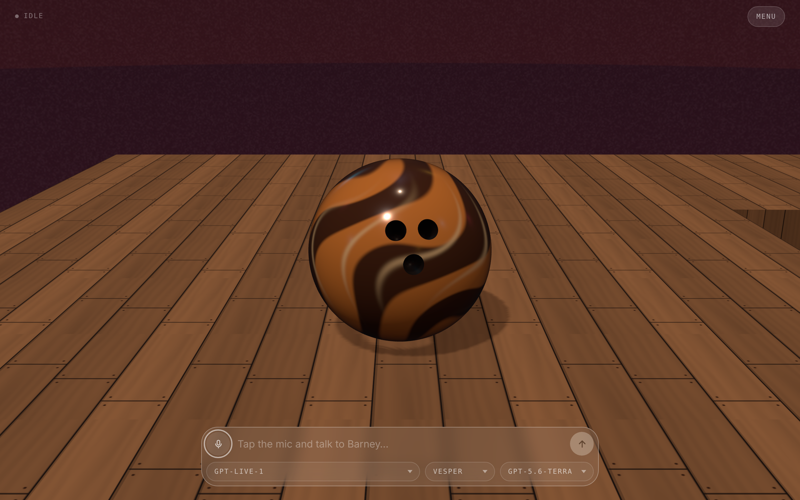
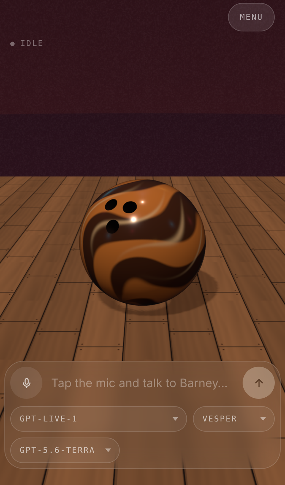

# Barney

A voice agent rendered as a bowling ball. Barney is a tiger-resin flame ball
with three finger holes for a face, and he likes bowling, pool, darts, beer and
sports of every kind. He rolls round a wooden floor in a dive bar while he
talks, stops and turns his holes toward you while he listens, spins on the spot
while he thinks, and looks at the pointer when you move it — all of it driven by
a live OpenAI GPT-Live conversation,
with a Responses backend for reasoning and tools. He remembers what you tell him
to, between calls.

He is the first voice agent built on
[madness-engine](https://github.com/h1ddenpr0cess20/madness-engine): the ball,
the stage, the physics he rolls on and the gaze are the engine's, and the voice is the
same wiring [Marc](https://github.com/h1ddenpr0cess20/marc) uses.



<p align="center">
  
</p>

## Run

```sh
git clone https://github.com/h1ddenpr0cess20/barney
cd barney
npm install
cp .env.example .env      # add your OPENAI_API_KEY
npm run dev               # → http://localhost:5173
```

Requires API access to `gpt-live-1` and to the backend model (`gpt-5.6-terra`
by default). Voice duration and backend tokens are billed separately.

`npm install` fetches the engine from GitHub, so it needs `git`.

Click the mic, allow the browser's microphone prompt, and start talking.

Three pickers sit under the composer: the GPT-Live model that does the talking,
the voice it talks in (Vesper by default), and the Responses model behind it that
reasons and looks things up. Changing any of them redials and keeps the
conversation.

Tapping the mic is the microphone switch: turning it off stops what you send and
leaves the answer playing, and the conversation is still there when you turn it
back on. It also switches itself off after a minute of silence, and the call
survives that too. Holding the mic down is the hang-up — a ring closes around it
while you hold, and the call ends when it lands.

`menu`, in the top corner, is where the panels live: `tools`, `memory` and the
log, one row each.

`tools` includes web search, on by default. Ask Barney about last night's score
and the backend can go and look while he keeps talking. What it read appears as
clickable links under the caption, and goes when the caption does.

The log keeps every conversation. `continue` on one picks it back up: the call is
dialled again with those turns handed over as context, and what you say from
there lands in the same entry rather than a new one.

| Script | |
|---|---|
| `npm run dev` | Vite, with the proxy mounted as middleware — one process |
| `npm run dev:lan` | The same, over HTTPS on the network — for a phone |
| `npm run build` | Bundles the client to `dist/` |
| `npm start` | Serves `dist/` with the same proxy in front |
| `npm run preview` | `build` then `start` |
| `npm run preview:lan` | `build` then `start`, over HTTPS on the network |
| `npm test` | `node:test` over the client and server |
| `npm run lint` | ESLint |

To run it on a phone, or in Docker, see
[configuration](docs/configuration.md#on-a-phone).

## Docs

- [**Configuration**](docs/configuration.md) — every environment variable, the
  voice picker, the HTTPS setup a phone needs for microphone access, and Docker.
- [**Design notes**](docs/design.md) — how the call is wired, what's in
  `localStorage`, the ball and its moods, the source layout, and the seam another
  provider would have to implement.
- [**AI Output Disclaimer**](docs/ai-output-disclaimer.md) — what the model says
  is the model's, not the author's, plus the risks that are specific to a live
  microphone and speech you hear before anyone can check it.
- [**Not a Companion**](docs/not-a-companion.md) — Barney is a toy and a demo.
  It is not a friend, a therapist, or a partner, and the project will not grow in
  that direction.
